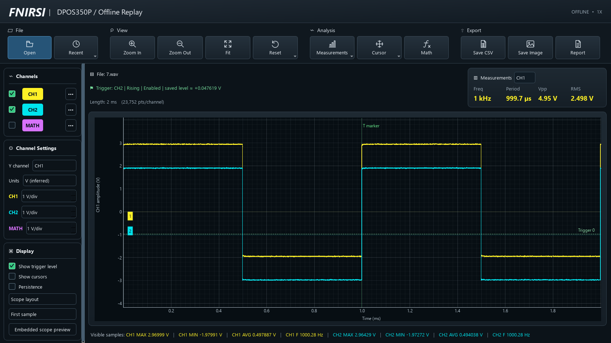
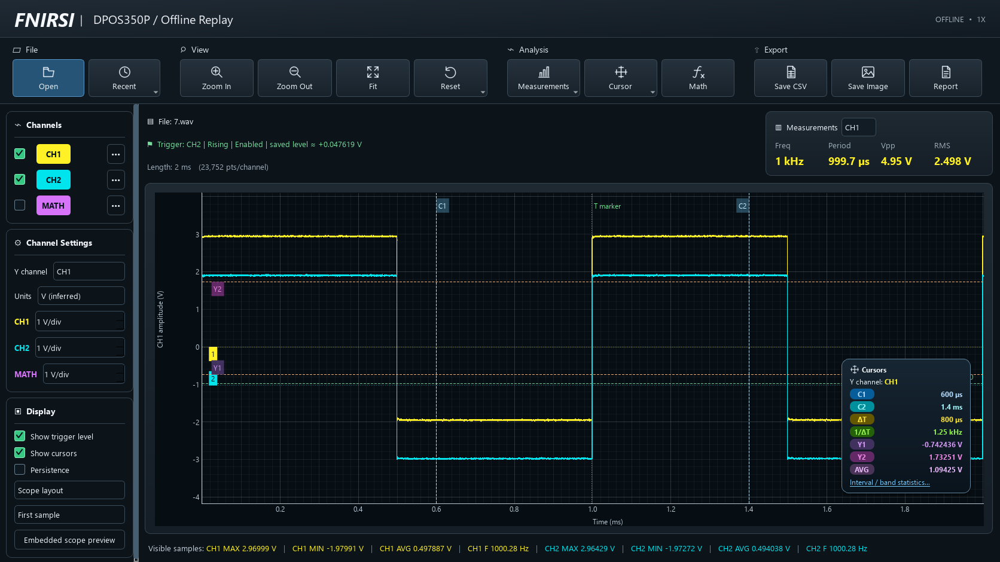

# FNIRSI DPOS350P Offline Reader

Unofficial Windows viewer for FNIRSI DPOS350P waveform WAV files, built with **PySide6 and PyQtGraph**. Samples and measurements come from the waveform file, never from screenshots.





## Download and run

Download **DPOS350P-Reader.exe** from [Releases](https://github.com/jhalilaj/DPOS350P-Reader/releases). The single-file Windows build does not need a separate `_internal` folder or Python installation. It extracts its bundled runtime to a temporary folder while running, so startup can take a few seconds.

To run from source, install Python **3.11+**, run `Install-Dependencies.bat`, then `Open-Viewer.bat`. Alternatively:

```powershell
python -m venv .venv
.venv\Scripts\python -m pip install -r requirements.txt
.venv\Scripts\python src/app.py
```

Open a scope WAV using **Open**, Ctrl+O, or drag-and-drop. Wheel to zoom; drag the waveform to pan. Drag channel markers to adjust display positions. Drag X/Y cursor lines or their labeled handles to measure intervals and amplitude bands; the cursor card shows the selected Y channel and band average.

Features include channel visibility and scales, raw/inferred volts, saved-view restoration, measurements, CH1−CH2 math, trigger indicators, embedded preview, and CSV/PNG/SVG/JSON exports. **Report** exports a reader JSON snapshot; it is an application feature, not a development report.

## Source layout

```text
src/
  app.py          Application entry point
  decoder/        Waveform parsing, calibration and measurements
  ui/             Qt interface and background jobs
  exports/        CSV/image/JSON export support
  assets/         Application icon
packaging/        Single-file PyInstaller build configuration
tests/
  fixtures/       Example waveform files
  reports/        Existing test results, with original versions retained
images/           README screenshots
```

Run tests from the repository root:

```powershell
$env:PYTHONPATH = "$PWD/src"
python -m unittest discover -s tests -p "test*.py"
```

Build Windows:

```powershell
python -m pip install pyinstaller
python -m PyInstaller --noconfirm packaging/DPOS350P-Reader.spec
```

The output is `dist/DPOS350P-Reader.exe`.

## Support and license

The observed layout has been checked against 24 supplied captures, including seven 1X references. Unrecognized/inconsistent settings remain raw-only. Offline measurements are estimates. BMP screenshots and reduced CAP waveform profiles are not supported as sample inputs. Persistence is disabled because static files contain no acquisition history.

[MIT License](LICENSE). Not affiliated with FNIRSI. The license covers this project's code, not vendor firmware, documentation or trademarks.
